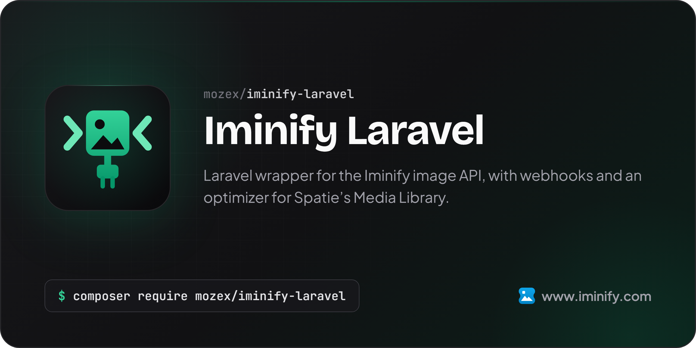

[](https://mozex.dev/docs/iminify-laravel)

# Iminify Laravel

[](https://packagist.org/packages/mozex/iminify-laravel)
[](https://github.com/mozex/iminify-laravel/actions/workflows/checks.yml)
[](https://mozex.dev/docs/iminify-laravel/v1)
[](https://packagist.org/packages/mozex/iminify-laravel)
[](https://packagist.org/packages/mozex/iminify-laravel)

[Iminify](https://www.iminify.com) for Laravel. It puts the [PHP client](https://github.com/mozex/iminify-php) in your app's container behind an `Iminify` facade, and plugs Iminify into Spatie's Media Library and laravel-image-optimizer, so conversions and uploads come out smaller with no jpegoptim, pngquant or cwebp on the server. It also has a webhook route that checks each signature and a fake for your tests.

> **[Read the full documentation at mozex.dev](https://mozex.dev/docs/iminify-laravel/v1)**: searchable docs, version requirements, detailed changelog, and more.

## Table of Contents

- [Installation](#installation)
- [Calling the API](#calling-the-api)
- [Media Library](#media-library)
  - [Responsive images](#responsive-images)
  - [What it costs](#what-it-costs)
  - [Optimizing again later](#optimizing-again-later)
- [laravel-image-optimizer](#laravel-image-optimizer)
- [Your own chain](#your-own-chain)
- [Configuration](#configuration)
- [When a file can't be optimized](#when-a-file-cant-be-optimized)
- [Webhooks](#webhooks)
- [Faking Iminify in your tests](#faking-iminify-in-your-tests)

## Support This Project

I maintain this package along with [several other open-source PHP packages](https://mozex.dev/docs) used by thousands of developers every day.

If my packages save you time or help your business, consider [**sponsoring my work on GitHub Sponsors**](https://github.com/sponsors/mozex). Your support lets me keep these packages updated, respond to issues quickly, and ship new features.

Business sponsors get logo placement in package READMEs. [**See sponsorship tiers →**](https://github.com/sponsors/mozex)

## Installation

> **Requires [PHP 8.2+](https://php.net/releases/)** - see [all version requirements](https://mozex.dev/docs/iminify-laravel/v1/requirements)

```bash
composer require mozex/iminify-laravel
```

Then publish `config/iminify.php` with the install command:

```bash
php artisan iminify:install
```

Make an API key under Settings, API Tokens on [www.iminify.com](https://www.iminify.com), and put it in your `.env`:

```dotenv
IMINIFY_API_KEY=your-key
```

## Calling the API

The `Iminify` facade is the client from [mozex/iminify-php](https://github.com/mozex/iminify-php), made once from your config, so every call that package documents works here:

```php
use Mozex\Iminify\Laravel\Facades\Iminify;

$image = Iminify::images()->upload(storage_path('app/photos/team.jpg'), ['format' => 'webp']);
$image = Iminify::images()->wait($image);

if ($image->hasResult()) {
    Iminify::images()->download($image)->saveTo(storage_path('app/photos/team.webp'));
}
```

You can also type-hint `Mozex\Iminify\Client` in a constructor or job and the container hands you the same client. Every request it sends carries an `Iminify-Client: laravel/<version>` header, which Iminify uses only to count which clients are in use.

One request may take `IMINIFY_TIMEOUT` seconds, 30 by default. A wait is many requests and has its own limit, `wait()`'s second argument.

## Media Library

Put the optimizer in `image_optimizers` in `config/media-library.php`, in place of jpegoptim, pngquant, optipng, gifsicle and cwebp, and keep svgo and avifenc for the SVG and AVIF files Iminify doesn't read:

```php
'image_optimizers' => [
    Mozex\Iminify\Laravel\IminifyOptimizer::class => [],
    Spatie\ImageOptimizer\Optimizers\Svgo::class => [
        '--disable=cleanupIDs',
    ],
    Spatie\ImageOptimizer\Optimizers\Avifenc::class => [
        '-a cq-level=23',
        '-j all',
        '--min 0',
        '--max 63',
        '--minalpha 0',
        '--maxalpha 63',
        '-a end-usage=q',
        '-a tune=ssim',
    ],
],
```

Keep at least one of Spatie's own optimizers in that list in any case. Media Library builds the chain with spatie/image-optimizer's factory, which only recognizes Spatie's seven built-in classes, and a list holding none of them gets the default binaries instead, without a word.

Every JPEG, PNG, WebP and GIF conversion then goes through Iminify and comes back in its own format. Queued conversions work as they are: the optimizer carries only its options onto the queue, and takes the API key from your config when it runs. An `api_key` in a list's options is ignored, so it never lands in a queued job. Media Library never optimizes the uploaded file itself, only its conversions.

To use Iminify for some conversions and leave the rest on the binaries, keep the config as it is and give those conversions their own chain:

```php
use Mozex\Iminify\Laravel\IminifyOptimizer;

public function registerMediaConversions(?Media $media = null): void
{
    $this->addMediaConversion('thumb')
        ->width(400)
        ->optimize(IminifyOptimizer::chain());
}
```

The package supports Media Library 11.23 and newer.

### Responsive images

Media Library's responsive images ignore `image_optimizers` and always run the default binaries. Turn this on to send each width through the chain `image_optimizers` builds instead, with Iminify added when the list lacks it, so an AVIF width still reaches avifenc:

```dotenv
IMINIFY_RESPONSIVE_IMAGES=true
```

The package then binds its own `ResponsiveImageGenerator`, which is Media Library's with the optimizer chain swapped.

### What it costs

Each file the optimizer sends counts as one image against your plan's daily images, the same as an upload on the website. An upload to a model with a `thumb` and a `preview` conversion counts two. With responsive images on, every width counts one more, and Media Library usually makes several widths per image. `Iminify::account()->get()` tells you what's left today.

### Optimizing again later

For media you already have, or after changing the config, have Media Library build the conversions again:

```bash
php artisan media-library:regenerate
```

Each regenerated conversion counts again, so narrow the run where you can: `--only=thumb`, a model name as the first argument, or `--ids=`.

## laravel-image-optimizer

Put the optimizer in `optimizers` in `config/image-optimizer.php`, in place of jpegoptim, pngquant, optipng, gifsicle and cwebp:

```php
'optimizers' => [
    Mozex\Iminify\Laravel\IminifyOptimizer::class => [],
    Spatie\ImageOptimizer\Optimizers\Svgo::class => [
        '--disable=cleanupIDs',
    ],
],
```

`ImageOptimizer::optimize($path)` and the `OptimizeImages` middleware then go through Iminify. The middleware waits for every uploaded file inside the request, usually a few seconds each, so on a busy form you may prefer to optimize from a queued job after saving.

## Your own chain

`IminifyOptimizer::chain()` is a Spatie `OptimizerChain` holding only this optimizer, which spatie/image and Browsershot take too:

```php
use Mozex\Iminify\Laravel\IminifyOptimizer;
use Spatie\Image\Image;

Image::load($path)->width(1200)->optimize(IminifyOptimizer::chain())->save();
```

## Configuration

`config/iminify.php` holds:

| Key | Env | Default | What it does |
|---|---|---|---|
| `api_key` | `IMINIFY_API_KEY` | none | The key every request sends |
| `base_uri` | `IMINIFY_BASE_URI` | `https://www.iminify.com/api/v1` | Where the API answers |
| `timeout` | `IMINIFY_TIMEOUT` | `30` | Seconds one request may take |
| `optimizer.level` | `IMINIFY_LEVEL` | the API's, `smart` | `none`, `lossless`, `smart` or `ultra` |
| `optimizer.keep_metadata` | | `false` | Keep EXIF and the like |
| `optimizer.timeout` | | `120` | Seconds the optimizer waits for one file |
| `media_library.responsive_images` | `IMINIFY_RESPONSIVE_IMAGES` | `false` | Send responsive widths through Iminify |
| `webhooks.secret` | `IMINIFY_WEBHOOK_SECRET` | none | Your webhook's signing secret |
| `webhooks.tolerance` | | `300` | Seconds a webhook's time may be off from your clock |

An option in a config list overrides `optimizer` for that list:

```php
Mozex\Iminify\Laravel\IminifyOptimizer::class => ['level' => 'ultra'],
```

The optimizer never asks for alt text, keeps each file's format, and writes back only a smaller copy. It deletes each image from your Iminify account when it's done with the file, whether or not it wrote anything back.

## When a file can't be optimized

The file stays as it was. A spent daily allowance, a timeout, a refused key or an answer the optimizer won't trust leaves the image unoptimized, and nothing else breaks. Spatie's chain logs the reason to its own logger, which is off by default, and the package dispatches `OptimizationSkippedEvent` with the file's path and the exception:

```php
use Illuminate\Support\Facades\Event;
use Illuminate\Support\Facades\Log;
use Mozex\Iminify\Laravel\Events\OptimizationSkippedEvent;

Event::listen(function (OptimizationSkippedEvent $event) {
    Log::warning("Iminify skipped {$event->path}: {$event->reason->getMessage()}");
});
```

A listener that throws is reported to your exception handler, and never takes the place of the reason. A queued listener gets `$event->reason` as an `IminifyException` that names the original's class and message, since an exception's trace can hold things a queue can't carry.

## Webhooks

Register the route in `routes/web.php`. It leaves out the CSRF check, which a webhook can't pass, and the session and cookies, which a webhook doesn't keep:

```php
Route::iminifyWebhooks();
```

It answers at `/iminify/webhooks` under the name `iminify.webhooks`; pass another address and name as its arguments. Save the address under Settings, Webhooks on www.iminify.com, and put the signing secret it shows in your `.env`:

```dotenv
IMINIFY_WEBHOOK_SECRET=whsec_...
```

The route checks the signature against the raw body, answers anything that doesn't match with a 400, and dispatches `WebhookReceivedEvent` for the rest:

```php
use Illuminate\Support\Facades\Event;
use Mozex\Iminify\Enums\WebhookEventType;
use Mozex\Iminify\Laravel\Events\WebhookReceivedEvent;

Event::listen(function (WebhookReceivedEvent $received) {
    if ($received->event->type === WebhookEventType::ImageCompleted) {
        $image = $received->event->image();
    }
});
```

`$received->event->id` stays the same when a failed send is sent again, so you can skip one you've handled. Iminify counts a send as failed when the answer takes longer than the limit its [webhooks guide](https://www.iminify.com/docs/webhooks) states, so a listener with slow work should implement `ShouldQueue`.

## Faking Iminify in your tests

`Iminify::fake()` swaps the client for one that answers what you queue, in order, and keeps every call to assert on. The optimizer uses it too, and a wait never sleeps:

```php
use Mozex\Iminify\Laravel\Facades\Iminify;
use Mozex\Iminify\Testing\Fixtures;

Iminify::fake([
    Fixtures::image(['id' => 'abc']),
    Fixtures::refusal('daily_limit_reached', 429),
]);

$image = Iminify::images()->get('abc');

Iminify::assertSent('GET', 'images/abc');
```

`Fixtures` holds an example answer for every record the API returns, and a queued exception is thrown in its turn. The optimizer waits out a rate limit with Laravel's `Sleep`, so `Sleep::fake()` keeps those waits out of your tests too. To test your webhook listener, sign a body with `(new WebhookVerifier($secret))->sign($body)` from the PHP client and post it to the route with the `Iminify-Signature` header.

## Resources

Visit the [documentation site](https://mozex.dev/docs/iminify-laravel/v1) for searchable docs auto-updated from this repository.

- **[AI Integration](https://mozex.dev/docs/iminify-laravel/v1/ai-integration)**: Use this package with AI coding assistants via Context7 and Laravel Boost
- **[Requirements](https://mozex.dev/docs/iminify-laravel/v1/requirements)**: PHP, Laravel, and dependency versions
- **[Changelog](https://mozex.dev/docs/iminify-laravel/v1/changelog)**: Release history with linked pull requests and diffs
- **[Contributing](https://mozex.dev/docs/iminify-laravel/v1/contributing)**: Development setup, code quality, and PR guidelines
- **[Questions & Issues](https://mozex.dev/docs/iminify-laravel/v1/questions-and-issues)**: Bug reports, feature requests, and help
- **[Security](mailto:hello@mozex.dev)**: Report vulnerabilities directly via email

## License

The MIT License (MIT). Please see [License File](LICENSE.md) for more information.
